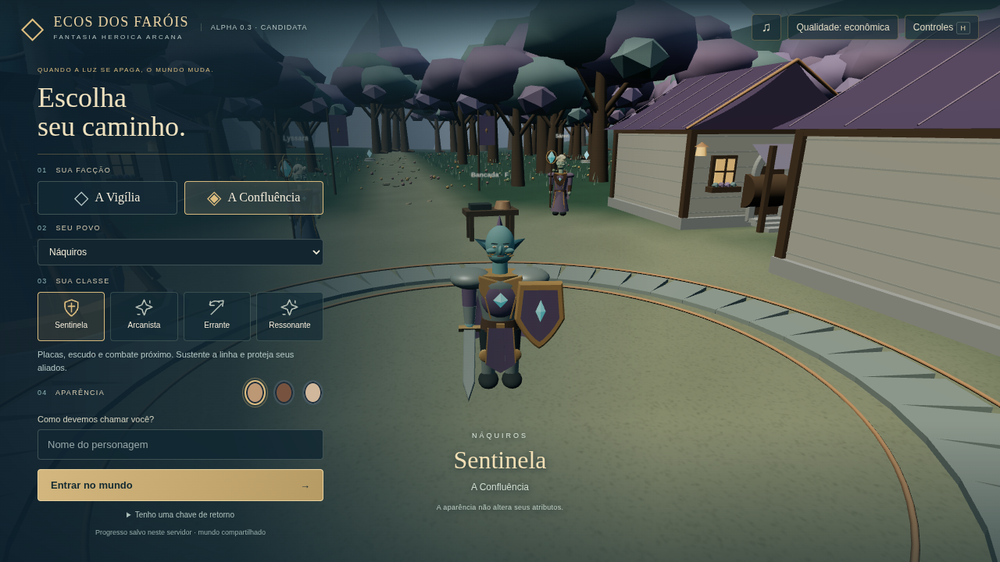
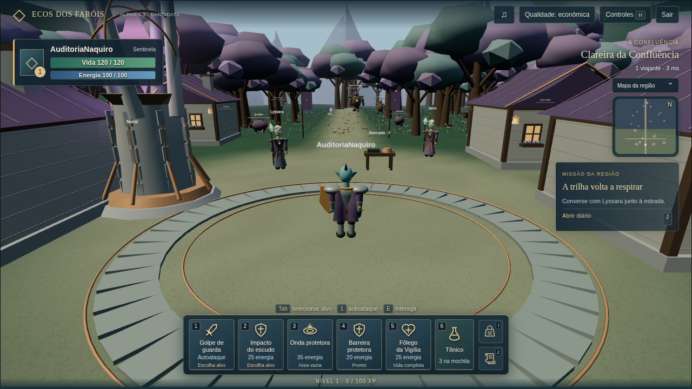

# Verificações desta auditoria

Execução em Linux da nuvem, em 18/10/2026 UTC (17/10/2026 no horário de São Paulo). Os logs preservam o horário UTC real. Nenhum resultado abaixo é uma nova validação Windows ou a aprovação do futuro personagem.

| Verificação | Resultado observado | Evidência |
| --- | --- | --- |
| Inventário da baseline | 189 arquivos; nenhum banco `.sqlite`/`.db`/lock presente na pasta do jogo | [game-baseline.json](evidencias/game-baseline.json) |
| Instalação isolada | `npm ci --no-audit --no-fund`, lockfile preservado, saída 0 | [npm-ci.log](evidencias/npm-ci.log) |
| Build da baseline copiada | TypeScript servidor/cliente e Vite aprovados, saída 0 | [build.log](evidencias/build.log) |
| Testes isolados de render | 5/5, zero falhas/skips/cancelamentos | [render-tests.log](evidencias/render-tests.log) |
| Suíte completa atual | 95/95, zero falhas/skips/cancelamentos | [full-suite.log](evidencias/full-suite.log) |
| Blender em background | 4.3.2, Python 3.13.5, operadores glTF registrados | [blender-probe.log](evidencias/blender-probe.log), [blender-smoke.log](evidencias/blender-smoke.log) |
| Render de ambiente Blender | Cena padrão em 64×64 concluída, saída 0; não é personagem produzido | [blender-smoke.log](evidencias/blender-smoke.log) |
| Navegador real | Criação Náquiro/Sentinela e entrada no mundo, duas capturas 1280×720 | [Relatório de capturas](evidencias/browser/LEIA_CAPTURAS_ATUAIS.md) |
| Preservação do jogo | Comparação integral dos nomes e SHA-256 antes/depois | [preservacao.json](evidencias/preservacao.json) |

## Ambiente e comandos realmente executados

Build/testes: Node **24.19.0**, npm **11.9.0**, cópia em `/workspace/edf-naquiro-auditoria/validation`. A cópia foi criada a partir do jogo no commit da baseline, sem usar seus dados reais nem instalar dependências sobre a distribuição original.

```sh
npm ci --no-audit --no-fund
npm run build
node --import tsx --test tests/render.test.ts
npm test
```

As saídas completas estão nos logs, sem mudança de expectativas dos testes. O aviso de fallback do ressonador no teste negativo é esperado: o teste realmente solicita um asset ausente e verifica a conservação da reserva. Os 5 testes de render são um subconjunto dos 95, não mais 5 testes distintos. A suíte testa a versão atual, não um rig novo inexistente.

Navegador: Node **24.14.0**, Chromium **154.0.8037.57**, Linux/SwiftShader em software, modo econômico. Servidor iniciado da distribuição Alpha 0.3 já entregue, com banco sintético e porta própria 18911; entrada pelo fluxo legado normal. Essa evidência demonstra o visual atual e a entrada nesse fluxo, não uma nova validação do fluxo de contas ou da falha Windows B1.1. O [resultado estruturado](evidencias/browser/current-naquiro-result.json) registra saúde antes/depois, ausência de erros e encerramento SIGTERM com saída 0.

Capturas:





O harness externo pausa `requestAnimationFrame` depois de um frame real e renderiza um frame na resolução de captura. Não altera câmera, personagem, saves ou mensagens. Está documentado no relatório; isso não mede FPS nem demonstra animação contínua. `asset: loaded` refere-se ao ressonador arquitetônico, **não** a um GLB de personagem. O root do jogo segue inalterado.

## Avisos preservados e limites

- O build emite aviso conhecido de bundle acima de 500 kB; não foi escondido nem tratado por mudar o limite.
- O npm informa duas dependências transitivas descontinuadas; não houve atualização de lockfile nesta auditoria.
- O Blender registrou `EGL_BAD_MATCH` antes de concluir o render EEVEE e salvar o PNG de teste. Há renderização de ambiente disponível, mas nenhuma GPU física de produção foi validada.
- O Node do ensaio de navegador registra o aviso experimental de SQLite. O servidor permaneceu saudável e encerrou normalmente; isso não reproduz a queda Windows relatada anteriormente.
- Não foram criados `.blend`, GLB de personagem, mapas de pele, rig, clips, vídeos de animação nova ou métricas de desempenho do futuro Náquiro. Todos permanecem no plano.
- O Blender do PC do usuário não foi acessado; Windows, GPU real e avaliação artística do novo modelo continuam pendentes.
- Fixtures com bancos/credenciais sintéticas não integram a entrega pública. A conferência de preservação cobre todos os arquivos do jogo; bancos pessoais fora dele não foram acessados.

Não houve nova configuração de nuvem necessária: o Blender e os runtimes já estavam disponíveis. A skill `cloud-environment-onboarding:setup` foi usada para conferir capacidades e executar checks em cópia isolada; nenhum campo de configuração foi salvo ou alterado nesta etapa. A espera pela aprovação do plano vem da missão anexada, seção 8, não da skill.
