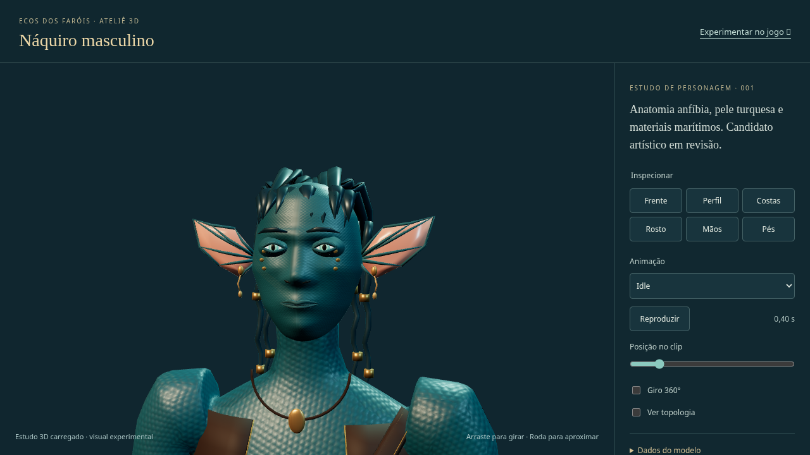
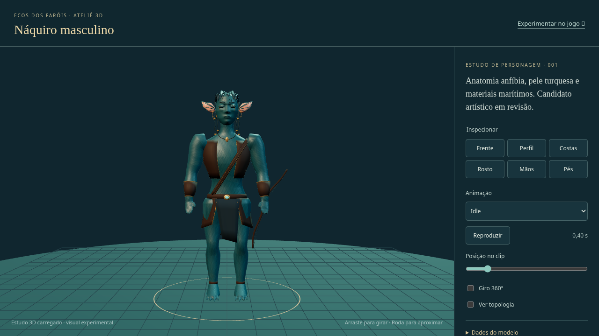

# Ecos dos Faróis — Náquiro masculino 001

**Candidato experimental `0.3.1-naquiro.1`; acabamento artístico e aceite Windows/GPU pendentes.** Build Linux aprovado e 109/109 testes. O visual é optativo e não migra saves.

Comece pelo [guia Windows PowerShell](../../../jogos/ecos-dos-farois/docs/WINDOWS_NAQUIRO_001.md) e pelo [relatório com resultados e pendências](RELATORIO.md).

## Baixar e jogar

Nesta pasta do GitHub, abra cada ZIP desejado e use **Download raw file** (ícone de seta para baixo). Não use os links `sandbox:` das conversas anteriores.

1. Baixe **todos os arquivos `Ecos_dos_Farois_Naquiro_001_Jogo*.zip`** e o `SHA256SUMS.txt`.
2. Confira os hashes com `Get-FileHash -Algorithm SHA256`. Extraia todas as partes **na mesma pasta nova**, sem concatenar os ZIPs e sem sobrepor a instalação anterior.
3. Entre na pasta `Ecos_dos_Farois_Naquiro_001` e siga o guia PowerShell. Para apenas jogar, o pacote traz build e dependência do servidor; precisa de Node 24.13+ da linha 24.
4. Use navegador anônimo/perfil separado e bancos novos de laboratório. Abra `/?character=naquiro-male`, selecione **Confluência → Náquiros → Errante**. O ateliê está em `/character-lab.html`.

Os arquivos `Fontes_Blender*.zip` são opcionais para jogar. Extraia todas essas partes na mesma pasta principal se quiser abrir o `.blend`, importar o GLB ou regenerar o modelo. O patch altera a baseline indicada no relatório; as fontes Blender são entregues separadamente.

Se o download pelo navegador continuar sem funcionar e você tiver Git instalado, uma alternativa é obter uma cópia nova pelo PowerShell:

```powershell
$dest = 'edf-naquiro-' + (Get-Date -Format 'yyyyMMdd-HHmmss')
if (Test-Path -LiteralPath $dest) { throw 'Escolha outra pasta de destino.' }
git clone --config core.autocrlf=false --single-branch --branch entrega/edf-naquiro-001 https://github.com/EuqirneH94/projetinhos.git $dest
if ($LASTEXITCODE -ne 0) { throw 'O clone falhou; preserve sua instalação anterior.' }
Set-Location (Join-Path $dest 'jogos/ecos-dos-farois')
node .\scripts\verify-files.mjs
if ($LASTEXITCODE -ne 0) { throw 'A cópia está incompleta ou divergente.' }
```

Depois, siga a seção de primeira execução do guia. Esses comandos criam uma pasta nova; não reutilizam os seus bancos antigos. A opção `core.autocrlf=false` conserva os bytes usados no manifesto, inclusive no Windows.

## Examinar o resultado

Capturas reais do Three.js após a correção de cores:

[Vídeo real do ateliê: corrida e órbita 360° (MP4)](evidencias/browser/naquiro-atelie-360.mp4). Gravação contínua de 50,28 s em renderização por software; não é vídeo de gameplay nem aprovação de FPS.





[Evidências e métodos](evidencias/LEIA.md) · [Revisão artística e divergências](evidencias/artistic-review.md) · [Procedência e limitações técnicas](../../../jogos/ecos-dos-farois/docs/CHARACTER_NAQUIRO_001.md).

[Baixar as evidências em ZIP](Ecos_dos_Farois_Naquiro_001_Evidencias.zip) · [Guia PowerShell avulso](WINDOWS_POWERSHELL.md) · [Hashes SHA-256](SHA256SUMS.txt).

O corpo, cabelo, face e roupa ainda precisam de refinamento, retopologia e revisão humana de fidelidade. Bioluminescência localizada também permanece pendente. A existência do rig e dos testes não constitui aprovação artística. O visual anterior continua disponível sem o parâmetro experimental.

## Arquivos desta entrega

| Arquivo | Tamanho |
| --- | --- |
| [Ecos_dos_Farois_Naquiro_001_Jogo_Parte_1_de_3.zip](Ecos_dos_Farois_Naquiro_001_Jogo_Parte_1_de_3.zip) | 18.59 MiB |
| [Ecos_dos_Farois_Naquiro_001_Jogo_Parte_2_de_3.zip](Ecos_dos_Farois_Naquiro_001_Jogo_Parte_2_de_3.zip) | 18.59 MiB |
| [Ecos_dos_Farois_Naquiro_001_Jogo_Parte_3_de_3.zip](Ecos_dos_Farois_Naquiro_001_Jogo_Parte_3_de_3.zip) | 18.59 MiB |
| [Ecos_dos_Farois_Naquiro_001_Fontes_Blender_Parte_1_de_2.zip](Ecos_dos_Farois_Naquiro_001_Fontes_Blender_Parte_1_de_2.zip) | 15.69 MiB |
| [Ecos_dos_Farois_Naquiro_001_Fontes_Blender_Parte_2_de_2.zip](Ecos_dos_Farois_Naquiro_001_Fontes_Blender_Parte_2_de_2.zip) | 15.56 MiB |
| [EDF_ALPHA_0_3_PARA_NAQUIRO_001.patch](EDF_ALPHA_0_3_PARA_NAQUIRO_001.patch) | 23.10 MiB |

Os três ZIPs Jogo são necessários para jogar. As duas partes Blender são opcionais para editar. Hashes completos: `SHA256SUMS.txt`. O empacotamento verificou 221 arquivos de runtime e 13 fontes de arte, CRC/união dos ZIPs e aplicação exata do patch.
