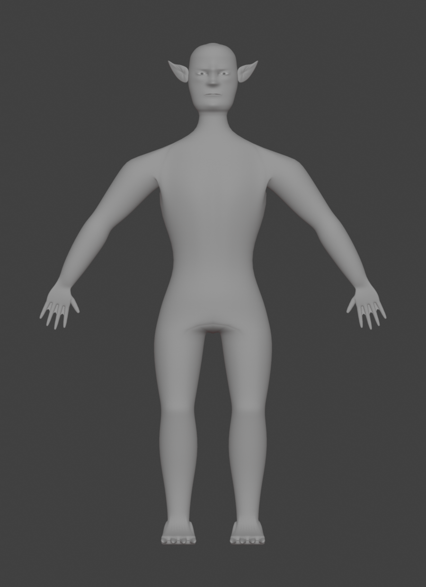
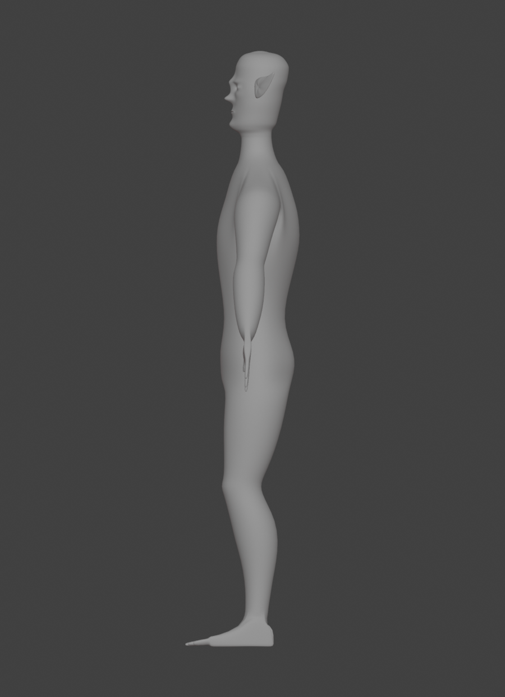
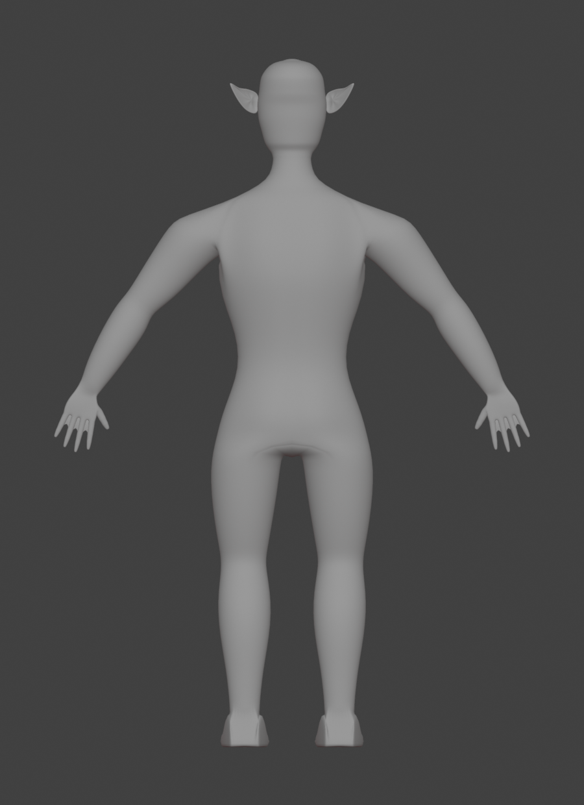

# Corpo base 002 — vistas reais do Blender

Corpo em material cinza neutro, roupas/cabelo/acessórios ocultos. Referências consultadas: VIS-018/019/020 da Bíblia V1.1.0. As imagens abaixo vêm do `.blend` SHA-256 `037b321e0d836390669cab741260ca9525ff62e9a5010892a28d49077d9c90db`; não receberam retoques. Clique para abrir cada PNG no tamanho original.

## Frente, perfil e costas

Mesma pose de repouso, escala ortográfica 2,60 e enquadramento de 900 × 1.240 pixels. A escala técnica do corpo não define a altura canônica da raça.

| Frente | Perfil | Costas |
| --- | --- | --- |
|  |  |  |

[Três quartos](evidencias/neutral/neutral-rest-three-quarter.png).

## Aproximações anatômicas

| Região | PNGs |
| --- | --- |
| Cabeça e rosto | [Frontal](evidencias/neutral/neutral-rest-face-front.png), [perfil](evidencias/neutral/neutral-rest-face-side.png), [três quartos](evidencias/neutral/neutral-rest-face-three-quarter.png) |
| Ombro, peito e axila | [Transição](evidencias/neutral/neutral-rest-shoulder.png) |
| Mãos | [Dorso](evidencias/neutral/neutral-rest-hand-dorsal.png), [palma](evidencias/neutral/neutral-rest-hand-palmar.png) |
| Pés | [Dorso](evidencias/neutral/neutral-rest-feet-dorsal.png), [perfil](evidencias/neutral/neutral-rest-feet-side.png), [planta isolada](evidencias/sole-detail/neutral-rest-feet-sole.png) |
| Barbatana auricular | [Detalhe](evidencias/neutral/neutral-rest-ear.png) |

A planta isolada usa o plano distante da câmera em 3,22 unidades, para retirar o corpo do fundo. A [vista plantar com o enquadramento original](evidencias/neutral/neutral-rest-feet-sole.png) também foi preservada. A geometria não foi cortada ou alterada no arquivo.

## Wireframe da malha de controle

As arestas pertencem ao cage real, com Subsurf desligado nesta visualização. O modificador Wireframe usa `offset=0` para mostrar os dois lados das superfícies finas; não é uma textura. A superfície subdividida das vistas neutras tem contagens diferentes, publicadas no relatório.

| Corpo | Aproximações |
| --- | --- |
| [Corpo inteiro](evidencias/wire/wire-rest-front.png) | [Rosto](evidencias/wire/wire-rest-face-front.png), [ombro](evidencias/wire/wire-rest-shoulder.png), [mão](evidencias/wire/wire-rest-hand-dorsal.png), [pés](evidencias/wire/wire-rest-feet-dorsal.png) |

## Poses de diagnóstico — deformação ainda sem aceite

As poses foram calculadas pelos ossos no Blender. O enquadramento de corpo inteiro se ajusta aos limites da geometria avaliada para incluir mãos e dedos. Os ângulos e as câmeras efetivas constam dos manifestos JSON de cada pasta.

| Pose | PNGs |
| --- | --- |
| Braços laterais | [Corpo](evidencias/poses/arms90/neutral-arms90-front.png), [ombro](evidencias/poses/arms90/neutral-arms90-shoulder.png) |
| Braços acima da cabeça | [Corpo](evidencias/poses/arms-up/neutral-arms-up-front.png), [ombro](evidencias/poses/arms-up/neutral-arms-up-shoulder.png) |
| Cotovelos a 90° | [Três quartos](evidencias/poses/elbow90/neutral-elbow90-three-quarter.png) |
| Joelho a 90° | [Três quartos](evidencias/poses/knee90/neutral-knee90-three-quarter.png) |
| Fechamento parcial de quatro dedos | [Dorso](evidencias/poses/hand-curl/neutral-hand-curl-hand-dorsal.png), [palma](evidencias/poses/hand-curl/neutral-hand-curl-hand-palmar.png) |
| Elevação dos dedos dos pés | [Dorso](evidencias/poses/toe-up/neutral-toe-up-feet-dorsal.png) |

O maior estiramento medido no corpo foi **3,58×** em braços elevados. O fechamento da mão revela uma aba angular/desalinhamento da membrana junto ao mínimo; o joelho apresenta compressão posterior. São limitações publicadas, não poses aprovadas para o runtime.

## Comparação com a fonte anterior

Cópias da anatomia 001, com roupas/cabelo/acessórios ocultos e o mesmo material cinza, câmeras e escala das vistas de repouso atuais. Os objetos originais continuam no checkpoint. Não compare estas imagens com o jogo como se fossem os seus materiais de runtime.

[Frente anterior](evidencias/comparison/baseline-rest-front.png) · [perfil anterior](evidencias/comparison/baseline-rest-side.png) · [costas anteriores](evidencias/comparison/baseline-rest-back.png) · [rosto anterior](evidencias/comparison/baseline-rest-face-front.png).

## Conferência com iluminação física

Cycles CPU, 32 amostras, três luzes de área, material neutro, 650 × 900 pixels, sem denoising disponível nesta compilação. Há ruído de amostragem; estas capturas servem para conferir a superfície por um método independente do Workbench.

[Corpo](evidencias/physical/neutral-rest-front.png) · [rosto em três quartos](evidencias/physical/neutral-rest-face-three-quarter.png) · [ombro](evidencias/physical/neutral-rest-shoulder.png).

## Inspeção e arquivos editáveis

[Relatório técnico](RELATORIO.md) · [parecer visual](evidencias/visual-review.md) · [inspeção estrutural JSON](evidencias/inspection/inspection-report.json) · [preservação dos 234 arquivos](evidencias/preservation-report.json) · [guia Windows](WINDOWS_POWERSHELL.md).

O `.blend` editável está no ZIP Fontes e nas [fontes no GitHub](https://github.com/EuqirneH94/projetinhos/tree/refino/edf-naquiro-anatomia-002/jogos/ecos-dos-farois/art-source/naquiro-male/anatomy-002). O aceite artístico permanece humano; roupas, texturas detalhadas e efeitos ficam para a etapa seguinte.
